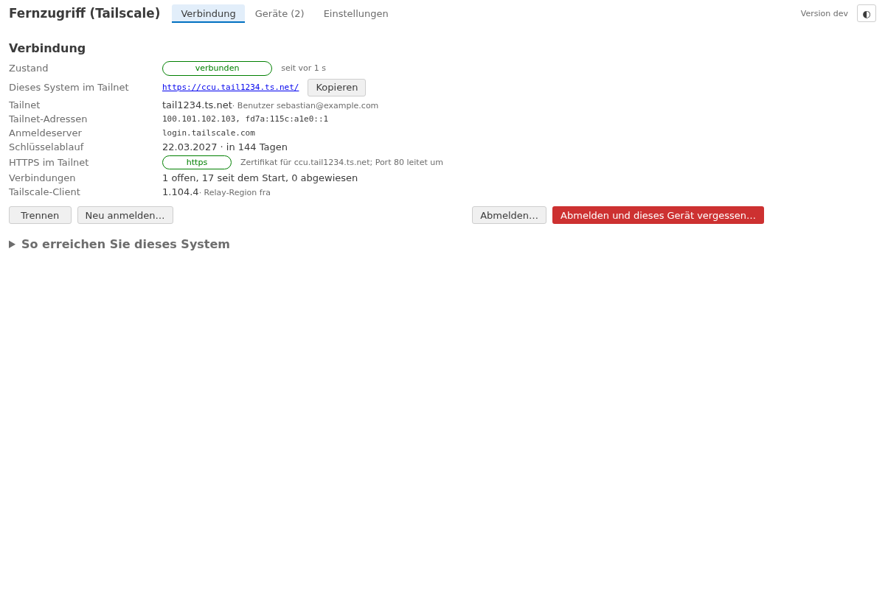
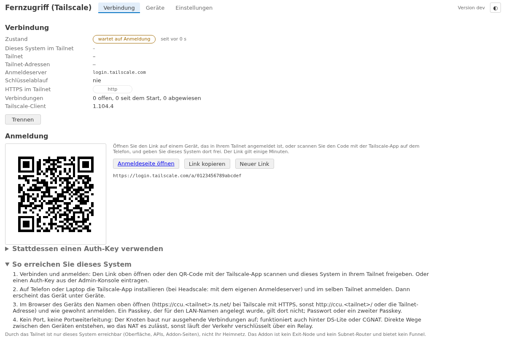
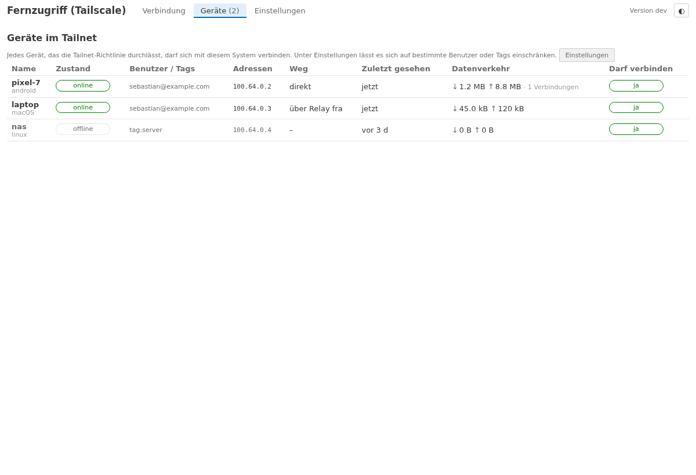
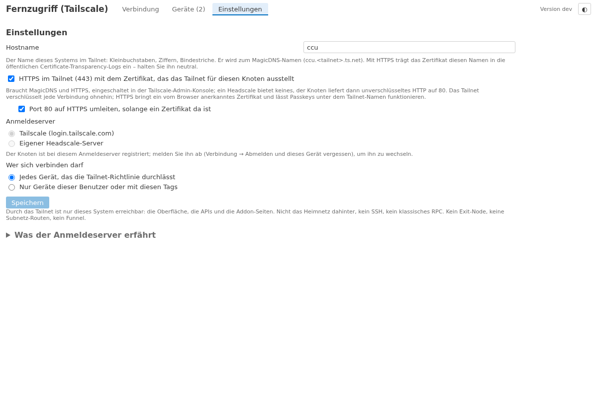

# lite-addon-tailscale

*[Deutsch](README.md)*

> **Requires openccu-lite 1.1.0-dev.6 or later** (the system's web ingress). On openccu-lite 1.0.0 the addon cannot be
> installed; the manifest names the minimum (`requires.lite`).

**Tailscale remote access** to an [openccu-lite](https://github.com/hobbyquaker/openccu-lite) system: a phone or laptop
with the Tailscale app reaches the user interface, the APIs and the addon pages from anywhere - and nothing else. No port
forward, no open port, behind DS-Lite or CGNAT too; a stable MagicDNS name (`ccu.<tailnet>.ts.net`) and a
browser-trusted certificate. Tailscale runs in userspace **inside the addon** (Tailscale's own library `tsnet`): no
kernel interface, no privilege, no root. The node hands the tailnet devices' web requests to the web server through the
system's **web ingress**, so the system sees the device's tailnet address and not the loopback. The login is with
Tailscale - or with your own [Headscale](https://headscale.net) server, then without Tailscale Inc.

## What it does

- **Nothing before consent.** Before the first *Connect* the page says what will be contacted and what the login server
  learns (the device name, the Tailscale version, the public and local IP addresses, when the system is online - not the
  content of connections). Until then the addon contacts nothing; installed, it is silent.
- **Login** with the Tailscale login link - as a button and as a QR code for the phone that already has the Tailscale
  app - or with an auth key from the admin console (used once, never stored). Log in again, log out, *log out and forget
  this device*.
- **Connection:** the state (connected, waiting for login, waiting for approval, offline, key expired), the MagicDNS name
  as a link with a copy button, the tailnet addresses, the user, the **key expiry** (a warning from 14 days before and
  when expired), the Tailscale version, the relay region, the connections.
- **HTTPS on the tailnet** with the certificate Tailscale issues for the node (switch MagicDNS and HTTPS on in the admin
  console); port 80 redirects. Without a certificate (Headscale) plain HTTP on 80 - the tailnet encrypts anyway. Both
  switchable.
- **Who may connect:** every device the tailnet policy lets through, or only devices of certain users or with certain
  tags - checked per connection against the tailnet's own record (WhoIs); others are refused before they reach the web
  server. The **Devices** tab lists the tailnet's devices with state, path (direct or via a relay), traffic and whether
  each may connect.
- **Headscale:** a login server field registers the node with a self-hosted Headscale instead of Tailscale Inc. With
  Headscale's own relay nothing of Tailscale is contacted. The Headscale needs a valid TLS certificate (an `https://`
  URL): the Tailscale clients reach its embedded relay over HTTPS only - with a Headscale on `http://` the node
  registers but no device gets through (the page then says the relay server is unreachable).
- **Only this system is reachable through the tailnet** - the user interface, the APIs, the addon pages. No exit node,
  no subnet routes, no Funnel, no Tailscale SSH; the home network behind the system stays out of reach.
- **Privacy:** log upload to Tailscale, UPnP/NAT-PMP, control-plane debug access, port-list and metrics reporting,
  self-update, Taildrop, Drive, the web client and SSH are compiled out of the binary. The page says when the system's
  backups are unencrypted: the node's keys are in them.

## Installation

1. Install the package `tailscale-<arch>-<version>.tar.gz` from the
   [releases page](https://github.com/hobbyquaker/lite-addon-tailscale/releases) through the system's Addons page. No
   port switch, no port forward: the node makes outgoing connections only.
2. Open the addon's page (*Remote access (Tailscale)* in the addon menu), read the consent card, choose the login server
   (Tailscale or your Headscale's URL) and **Connect**.
3. **Log in:** open the link or scan the QR code with the Tailscale app and approve this system in your tailnet - or
   enter an auth key (admin console → Settings → Keys; `headscale preauthkeys create`). A tagged key (`tag:ccu`) gives a
   node without key expiry.
4. For HTTPS switch **MagicDNS** and **HTTPS Certificates** on under DNS in the Tailscale admin console; the page then
   shows `https://ccu.<tailnet>.ts.net/`.
5. Log the Tailscale app on your phone or laptop in to the same tailnet and open the name from the page in the browser.
   A passkey made for the LAN name does not apply there: use the password or a second passkey.

## How it works

- The tailnet node lives inside the addon's process (`tsnet`: wireguard-go, gVisor's network stack, Tailscale's
  control client); its state - the keys, the identity, certificates - in
  `/usr/local/etc/config/addons/tailscale/state/` (0600), the configuration in `tailscale.json` beside it. Both are in
  the system's backup: a restore brings the same node back (hence the notice about backup encryption; and a backup
  restored onto a second system while the first still runs makes two nodes fight over one identity - switch the old
  system off first, or *log out and forget*).
- A tailnet device's connection to `ccu.<tailnet>.ts.net:443` (or `:80`) is accepted by the addon in its own stack, TLS
  terminated with the node's certificate, and handed to the web server's Unix socket that openccu-lite makes for addons
  with `web_ingress` in their manifest (`/run/lighttpd-addons/tailscale/proxy.sock`) - with a PROXY protocol header
  naming the device's tailnet address and, for 443, the SSL TLV, so the web server treats the request as HTTPS (secure
  cookies, no redirect). lighttpd and the system treat the request like one from the LAN with that address: the login
  lockout, API token address ranges and the journal see `100.x`. Addresses outside the declared tailnet ranges
  (`100.64.0.0/10`, `fd7a:115c:a1e0::/48`) are not accepted by the system.
- What a device reaches is the addon's decision: the web server alone. There is no route into the LAN and no way to the
  radio interfaces or the classic RPC.
- A new node needs one login; after that it comes back by itself at every start. A node's key expires after 180 days by
  default at Tailscale (switchable off per device in the admin console; tagged nodes have no expiry); the page warns
  before.
- The addon follows Tailscale's releases: a workflow in the repository notices a new Tailscale version, bumps the
  dependency, runs the checks (the Headscale test included) and on green publishes a new addon version - Tailscale and
  Headscale eventually refuse old clients.

## Development

`scripts/dev-serve.sh` runs the daemon with a stand-in node (`-demo`, contacts nothing) against a fake system (build
`ui/dist` first with `cd ui && npm run build`); the page is then at `http://127.0.0.1:18299/addons/tailscale/` without
the session check. `go test ./...` covers the configuration, the PROXY protocol, the API and the package;
`TS_DOCKER=1 go test ./test/headscale/` registers the real node and a second tsnet (the "phone") with a Headscale in
docker, fetches a page through the tailnet, checks the claimed address, the refusal of a stranger, the identity across a
restart, logout, the login link and the auth key. `cd ui && npm test && npx playwright test` covers the page.
`scripts/build.sh` builds the packages for aarch64, x86_64 and armv7l; `scripts/tags` is the list of Tailscale features
compiled out.

[docs/api.md](docs/api.md) documents the page's API. Licence: MIT. Tailscale is a trademark of Tailscale Inc.; this
addon is an independent project that embeds Tailscale's open-source client (BSD-3-Clause).
