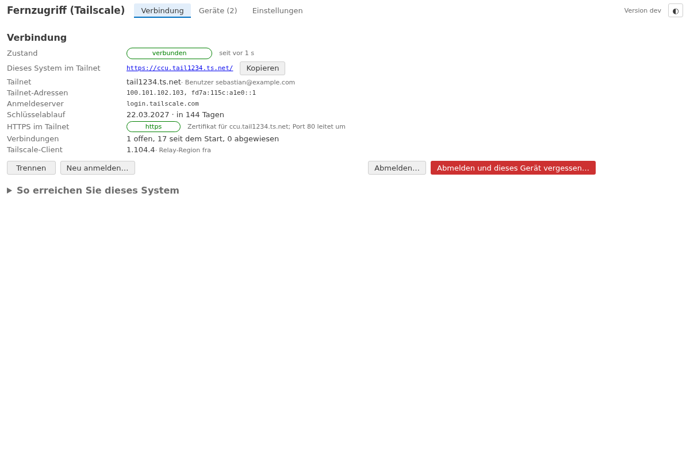
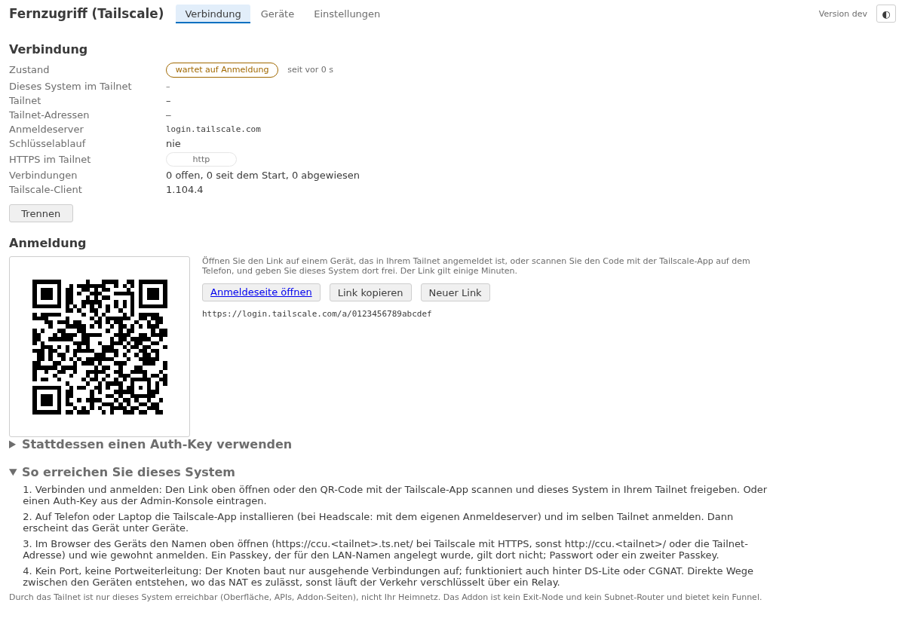
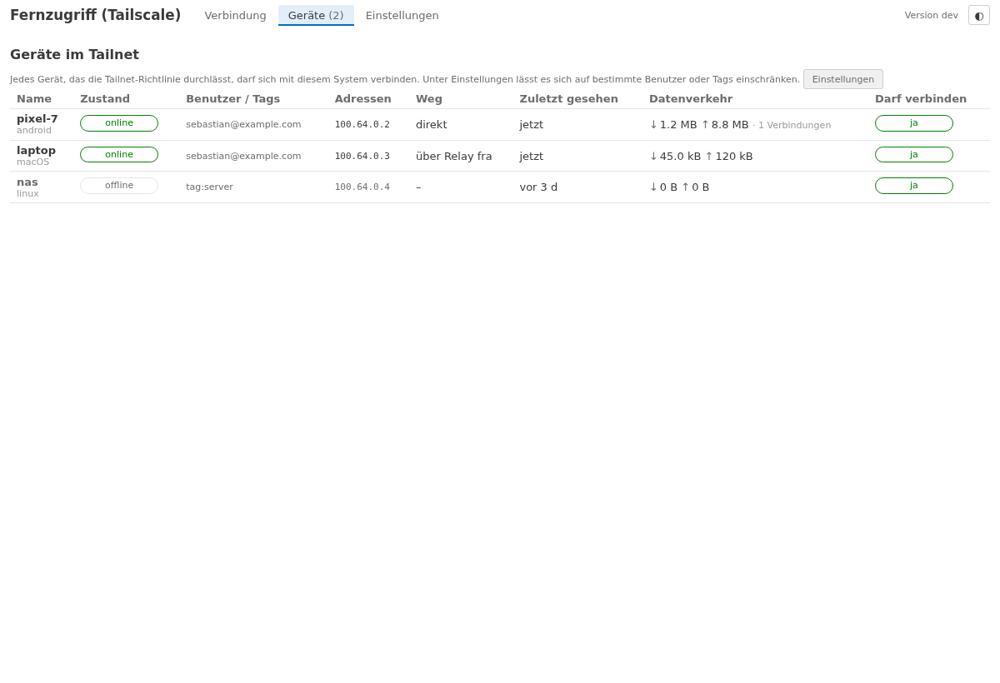
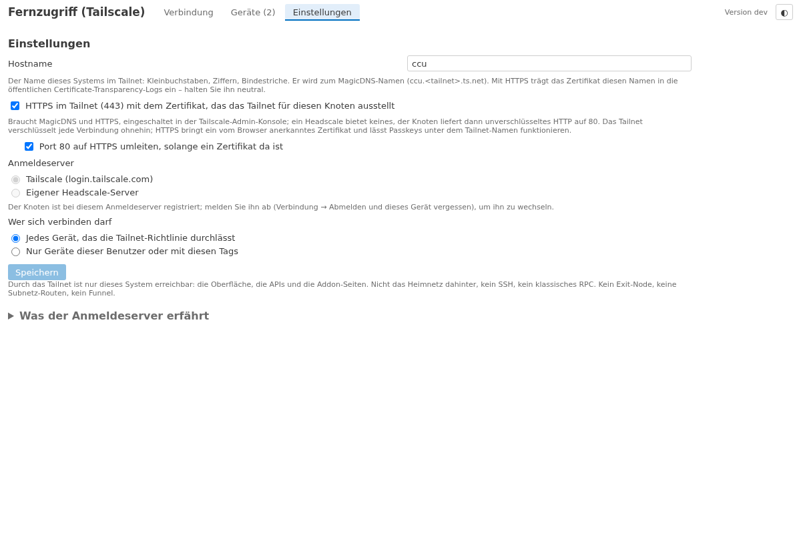

# lite-addon-tailscale

*[English](README.en.md)*

> **Benötigt openccu-lite 1.1.0-dev.6 oder neuer** (den Web-Eingang des Systems). Mit openccu-lite 1.0.0 lässt sich das
> Addon nicht installieren; das Manifest nennt die Mindestversion (`requires.lite`).

**Tailscale-Fernzugriff** auf ein [openccu-lite](https://github.com/hobbyquaker/openccu-lite)-System: Telefon oder
Laptop mit der Tailscale-App erreichen von unterwegs die Oberfläche, die APIs und die Addon-Seiten – und sonst nichts.
Keine Portweiterleitung, kein offener Port, funktioniert auch hinter DS-Lite oder CGNAT; ein fester MagicDNS-Name
(`ccu.<tailnet>.ts.net`) und ein vom Browser anerkanntes Zertifikat. Tailscale läuft im Userspace **im Addon selbst**
(Tailscales eigene Bibliothek `tsnet`): keine Kernel-Schnittstelle, kein Zusatzrecht, kein Root. Der Knoten reicht die
Web-Anfragen der Tailnet-Geräte über den **Web-Eingang des Systems** an den Webserver weiter, so dass das System die
Tailnet-Adresse des Geräts sieht und nicht den Loopback. Die Anmeldung läuft bei Tailscale – oder bei einem eigenen
[Headscale](https://headscale.net)-Server, dann ohne Tailscale Inc.

## Was es tut

- **Nichts vor der Einwilligung.** Die Seite sagt vor dem ersten *Verbinden*, was kontaktiert wird und was der
  Anmeldeserver erfährt (Gerätename, Tailscale-Version, öffentliche und lokale IP-Adressen, wann das System online ist –
  nicht den Inhalt der Verbindungen). Bis dahin kontaktiert das Addon nichts; installiert ist es stumm.
- **Anmelden** mit dem Tailscale-Anmeldelink – als Knopf und als QR-Code für das Telefon, das die Tailscale-App schon
  hat – oder mit einem Auth-Key aus der Admin-Konsole (einmal verwendet, nie gespeichert). Neu anmelden, abmelden,
  *abmelden und dieses Gerät vergessen*.
- **Verbindung:** Zustand (verbunden, wartet auf Anmeldung, wartet auf Freigabe, offline, Schlüssel abgelaufen), der
  MagicDNS-Name als Link mit Kopierknopf, die Tailnet-Adressen, der Benutzer, der **Schlüsselablauf** (Warnung ab 14
  Tage vorher und bei Ablauf), die Tailscale-Version, die Relay-Region, die Verbindungen.
- **HTTPS im Tailnet** mit dem Zertifikat, das Tailscale für den Knoten ausstellt (MagicDNS und HTTPS in der
  Admin-Konsole einschalten); Port 80 leitet um. Ohne Zertifikat (Headscale) unverschlüsseltes HTTP auf 80 – das Tailnet
  verschlüsselt ohnehin. Beides abschaltbar.
- **Wer sich verbinden darf:** jedes Gerät, das die Tailnet-Richtlinie durchlässt, oder nur Geräte bestimmter Benutzer
  oder mit bestimmten Tags – je Verbindung gegen die Angabe des Tailnets geprüft (WhoIs); andere werden abgewiesen,
  bevor sie den Webserver erreichen. Der Tab **Geräte** zeigt die Geräte des Tailnets mit Zustand, Weg (direkt oder über
  ein Relay), Datenverkehr und ob sie dürfen.
- **Headscale:** ein Anmeldeserver-Feld registriert den Knoten bei einem selbst betriebenen Headscale statt bei Tailscale
  Inc. Mit Headscales eigenem Relay wird dann nichts von Tailscale kontaktiert.
- **Durch das Tailnet erreichbar ist nur dieses System** – Oberfläche, APIs, Addon-Seiten. Kein Exit-Node, keine
  Subnetz-Routen, kein Funnel, kein Tailscale-SSH; das Heimnetz hinter dem System bleibt unerreichbar.
- **Privatsphäre:** Protokoll-Upload an Tailscale, UPnP/NAT-PMP, Debug-Zugriff der Kontrollebene, Portlisten- und
  Metrik-Meldungen, Selbstaktualisierung, Taildrop, Drive, Web-Client und SSH sind aus dem Binary herauskompiliert.
  Die Seite sagt, wenn die Backups des Systems unverschlüsselt sind: Die Schlüssel des Knotens stecken darin.

## Installation

1. Das Paket `tailscale-<arch>-<version>.tar.gz` von der
   [Releases-Seite](https://github.com/hobbyquaker/lite-addon-tailscale/releases) über die Addons-Seite des Systems
   installieren. Kein Port-Schalter, keine Portweiterleitung: Der Knoten baut nur ausgehende Verbindungen auf.
2. Die Addon-Seite öffnen (*Fernzugriff (Tailscale)* im Addon-Menü), die Einwilligungskarte lesen, den Anmeldeserver
   wählen (Tailscale oder die URL des eigenen Headscale) und **Verbinden**.
3. **Anmelden:** den Link öffnen oder den QR-Code mit der Tailscale-App scannen und dieses System im Tailnet freigeben
   – oder einen Auth-Key eintragen (Admin-Konsole → Settings → Keys; `headscale preauthkeys create`). Ein Schlüssel mit
   Tag (`tag:ccu`) ergibt einen Knoten ohne Schlüsselablauf.
4. Für HTTPS in der Tailscale-Admin-Konsole unter DNS **MagicDNS** und **HTTPS Certificates** einschalten; die Seite
   zeigt dann `https://ccu.<tailnet>.ts.net/`.
5. Auf Telefon oder Laptop die Tailscale-App im selben Tailnet anmelden und im Browser den Namen von der Seite öffnen.
   Ein Passkey, der für den LAN-Namen angelegt wurde, gilt dort nicht: Passwort oder ein zweiter Passkey.

## Wie es funktioniert

- Der Tailnet-Knoten lebt im Prozess des Addons (`tsnet`: wireguard-go, gVisors Netzwerkstack, Tailscales
  Kontrollclient), sein Zustand – die Schlüssel, die Identität, Zertifikate – in
  `/usr/local/etc/config/addons/tailscale/state/` (0600), die Konfiguration in `tailscale.json` daneben. Beides ist im
  Backup des Systems: Eine Wiederherstellung bringt denselben Knoten zurück (deshalb der Hinweis auf die
  Backup-Verschlüsselung; und: ein Backup auf einem zweiten System bei laufendem ersten lässt zwei Knoten um eine
  Identität streiten – das alte System vorher abschalten oder *abmelden und vergessen*).
- Verbindungen eines Tailnet-Geräts zu `ccu.<tailnet>.ts.net:443` (oder `:80`) nimmt das Addon in seinem Stack an,
  beendet TLS mit dem Zertifikat des Knotens und reicht sie an den Unix-Socket des Webservers weiter, den openccu-lite
  für Addons mit `web_ingress` im Manifest anlegt (`/run/lighttpd-addons/tailscale/proxy.sock`) – mit einem
  PROXY-Protocol-Header, der die Tailnet-Adresse des Geräts nennt, und für 443 dem SSL-TLV, so dass der Webserver die
  Anfrage als HTTPS behandelt (sichere Cookies, kein Umleiten). lighttpd und das System behandeln die Anfrage wie eine aus
  dem LAN von dieser Adresse: Anmeldesperre, Adressbereiche von API-Tokens und das Journal sehen `100.x`. Adressen
  außerhalb der deklarierten Tailnet-Bereiche (`100.64.0.0/10`, `fd7a:115c:a1e0::/48`) nimmt das System nicht an.
- Was ein Gerät erreicht, bestimmt das Addon: nur den Webserver. Es gibt keine Route ins LAN und keinen Weg zu den
  Funkschnittstellen oder zum klassischen RPC.
- Ein neuer Knoten braucht eine Anmeldung; danach kommt er bei jedem Start von selbst wieder. Der Schlüssel eines
  Knotens läuft bei Tailscale standardmäßig nach 180 Tagen ab (in der Admin-Konsole je Gerät abschaltbar; Knoten mit Tag
  haben keinen Ablauf); die Seite warnt vorher.
- Das Addon folgt Tailscales Releases: Ein Workflow im Repository bemerkt eine neue Tailscale-Version, hebt die
  Abhängigkeit an, lässt die Prüfungen (inklusive des Headscale-Tests) laufen und veröffentlicht bei Grün eine neue
  Addon-Version – ältere Clients lehnen Tailscale und Headscale irgendwann ab.

## Entwicklung

`scripts/dev-serve.sh` startet den Daemon mit einem Stellvertreter-Knoten (`-demo`, kontaktiert nichts) gegen ein
Fake-System (`ui/dist` vorher mit `cd ui && npm run build` bauen); die Seite ist dann unter
`http://127.0.0.1:18299/addons/tailscale/` ohne Sitzungsprüfung. `go test ./...` prüft Konfiguration, PROXY-Protokoll,
API und Paket; `TS_DOCKER=1 go test ./test/headscale/` registriert den echten Knoten und ein zweites tsnet (das
„Telefon") bei einem Headscale in Docker, holt eine Seite durch das Tailnet, prüft die beanspruchte Adresse, die
Abweisung eines Fremden, die Identität über einen Neustart, Abmeldung, Anmeldelink und Auth-Key. `cd ui && npm test &&
npx playwright test` prüft die Seite. `scripts/build.sh` baut die Pakete für aarch64, x86_64 und armv7l; `scripts/tags`
ist die Liste der herauskompilierten Tailscale-Funktionen.

[docs/api.md](docs/api.md) beschreibt die API der Seite. Lizenz: MIT. Tailscale ist eine Marke von Tailscale Inc.;
dieses Addon ist ein unabhängiges Projekt, das Tailscales Open-Source-Client (BSD-3-Clause) einbettet.
